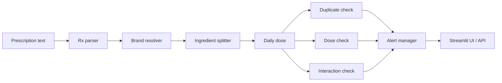

# RxGuard India — Prescription Safety Checker for Indian Brand Medicines

Decision-support tool for **deterministic, explainable** safety checks on Indian retail prescriptions. It is a **rules engine**, not an LLM judge: every alert cites a rule id, source label, and draft status.

> Not a medical device. Draft rules pending pharmacist verification. Do not use as the sole basis for clinical decisions.

## Problem

Indian prescriptions often list **brand names**. The same API (e.g. paracetamol) can hide across Dolo, Crocin, and Combiflam. Dose limits depend on age/weight/renal status. Clinically important interactions (warfarin + NSAIDs) are easy to miss when checking brands by eye.

## Solution

Parse free-text Rx lines → resolve brands against the India A–Z catalog → split combination products into ingredients → sum daily dose → run three checks (duplicate / dose / interaction) → merge alerts with tiers (`critical` / `review` / `info`).

## Architecture



## Setup

```bash
python3 -m venv venv
source venv/bin/activate
pip install -r requirements.txt
```

Requires `data/brands_clean.parquet` (from `src/clean_data.py`) and `data/ddinter/*.csv`. Interaction pairs are built with:

```bash
python -m src.build_interactions
```

## How to run

**Streamlit app**

```bash
streamlit run app.py
```

**API**

```bash
uvicorn src.api:app --reload --port 8000
# GET  /health
# POST /analyze
```

See [docs/API.md](docs/API.md).

**Tests / evaluation**

```bash
pytest
python evaluate.py   # writes docs/EVAL_REPORT.md
```

## Traceability

Every alert is a dict with `id`, `type`, `tier`, `title`, `reason`, `suggested_action`, `ingredients`, `brands`, `source_rule_id`, and `source_label`. Lookups go through `src/rules.py`:

1. Curated pairs in `data/rules/curated_interactions.json` (override)
2. DDInter pairs in `data/rules/ddinter_pairs.parquet`
3. Class-level expansion from `data/rules/classes.json`
4. Max dose from `data/rules/max_dose.json`

All rules ship with `verified_by_pharmacist: false` and `status: "DRAFT"`. Pharmacist checklist: [docs/PHARMACIST_REVIEW.md](docs/PHARMACIST_REVIEW.md).

## Data sources and licenses

| Source | Use |
|---|---|
| [A–Z Medicines Dataset of India (Kaggle)](https://www.kaggle.com/) | Brand catalog → `brands_clean.parquet` |
| [DDInter 2.0](https://ddinter.scbdd.com/) | Drug–drug interaction levels (academic use) |

Respect upstream licenses; DDInter is for academic / non-commercial research contexts unless you have other rights.

## Related work

- **RxCheck / similar Rx checkers** — often generic-name or US formulary focused; we start from **Indian brand strings** and expand combinations.
- **PillChecker-style apps** — often image/OCR or single-product lookup; we focus on **multi-line prescriptions**, **patient-aware dose limits**, **alert tiers**, and a **labeled gold evaluation** set.

We differ by: brand-level ingredient splitting, patient-aware dose limits (age/weight/renal), explicit alert tiers with merge logic, and developer-labeled evaluation pending pharmacist verification.

## Limitations

1. **3+ ingredient brands** are not fully representable in the two-composition catalog fields — some combos are incomplete.
2. **Syrup / suspension strength** is sometimes unclear (`per_unit_missing`); we emit info alerts instead of guessing.
3. **Rules are DRAFT** — numeric limits and interactions need pharmacist correction before any clinical use.
4. **Not a medical device** — decision support only; does not replace a clinician or pharmacist.

## Demo

See [demo/SCRIPT.md](demo/SCRIPT.md) for a 2-minute walkthrough.
